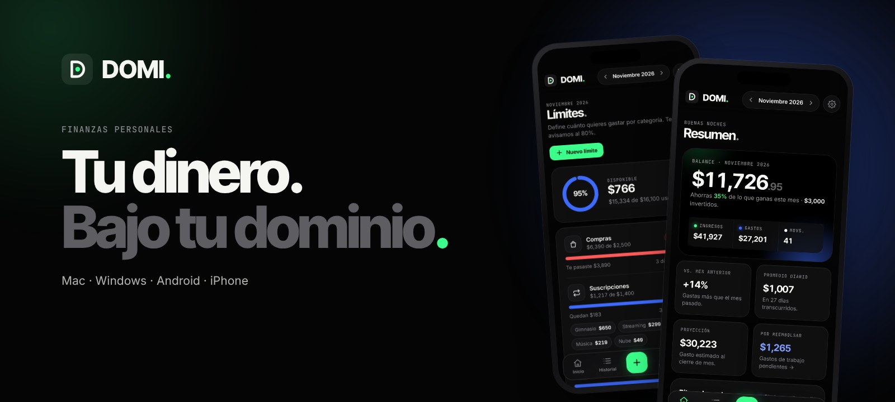
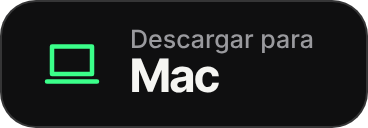
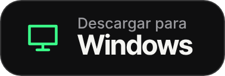
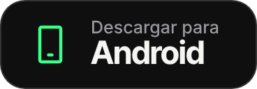
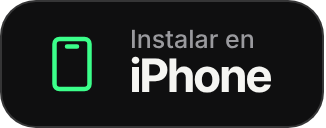
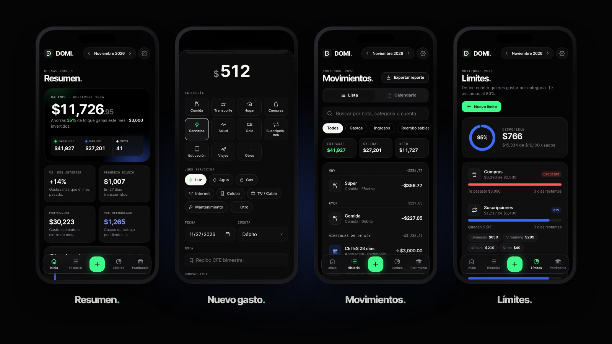
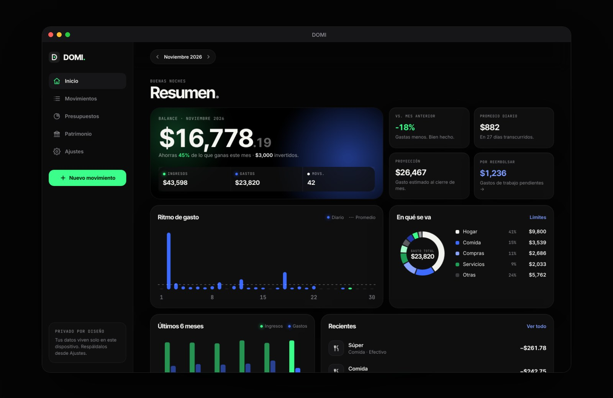

<p align="center">
  
</p>

<h3 align="center">Descarga DOMI</h3>

<p align="center">
  <a href="https://github.com/aloshkagarcia-designer/DOMI-/releases/latest/download/DOMI-mac.dmg"></a>
  <a href="https://github.com/aloshkagarcia-designer/DOMI-/releases/latest/download/DOMI-windows.exe"></a>
  <a href="https://github.com/aloshkagarcia-designer/DOMI-/releases/latest/download/DOMI-android.apk"></a>
  <a href="https://aloshkagarcia-designer.github.io/DOMI-/app/"></a>
</p>

<p align="center">
  <b>Mac</b> 11+ · Apple Silicon e Intel &nbsp;·&nbsp; <b>Windows</b> 10 y 11 &nbsp;·&nbsp; <b>Android</b> 6+ &nbsp;·&nbsp; <b>iPhone</b> desde Safari → Compartir → Agregar a inicio<br>
  <a href="https://aloshkagarcia-designer.github.io/DOMI-/">Página de descarga</a> · <a href="https://github.com/aloshkagarcia-designer/DOMI-/releases">Todas las versiones</a>
</p>

<p align="center">
  
</p>

<p align="center">
  
</p>

---

# DOMI · Finanzas personales

App de control de gastos personales para **Mac, Windows, Android e iPhone**. Estética premium negro y blanco con acentos en azul eléctrico y verde fósforo.

**Link para compartir:** https://aloshkagarcia-designer.github.io/DOMI-/
La página detecta el dispositivo y ofrece la descarga correcta.

## Funciones
- **Resumen**: balance del mes, tasa de ahorro, ritmo de gasto, gasto por categoría, comparativo de 6 meses y proyección al cierre.
- **Movimientos** con categoría, cuenta, fecha y nota; búsqueda y filtros.
- **Servicios y suscripciones detallados**: al elegir Servicios aparecen Luz, Agua, Gas, Internet, Celular, TV/Cable y Mantenimiento; en Suscripciones, Streaming, Música, Gimnasio, Apps, Nube y Videojuegos. Los límites muestran el desglose de cada uno.
- **Recibos y reembolsos**: foto del ticket y gastos de trabajo *Por reembolsar → Reembolsado*.
- **Importar estado de cuenta (CSV)**: lee el archivo de cualquier banco, detecta columnas, fechas y montos, categoriza solo (CFE, Telcel, Netflix, Uber, OXXO…), aprende tus correcciones, marca duplicados y excluye pagos a tarjeta.
- **Calendario de gastos**: cada día se pinta según cuánto gastaste; toca un día para ver sus movimientos. Incluye día más caro, días sin gastar y promedio diario.
- **Límites** por categoría con alertas al 80% y 100%.
- **Patrimonio**: metas de ahorro e inversiones (CETES, fondos, acciones/ETF, AFORE, cripto, bienes raíces) con rendimiento, distribución y evolución. Aportar a una inversión no cuenta como gasto.
- **Ajustes**: moneda, modo claro/oscuro, reporte CSV, respaldo e importación.
- **Sincronización entre dispositivos** (opcional): con una cuenta DOMI, lo que registras en el celular aparece en la computadora en segundos. Cifrado de extremo a extremo con tu contraseña: el servidor (Supabase) solo guarda datos ilegibles.
- **Privada**: sin cuenta, los datos viven solo en el dispositivo. Funciona sin conexión.

## Estructura
| Carpeta | Contenido |
|---|---|
| `www/` | La app (HTML, CSS, JS, íconos, fuentes). Es la misma en todas las plataformas. |
| `desktop/` | Ventana de escritorio (Electron) para Mac y Windows. |
| `android/` | Proyecto Android (Capacitor). |
| `site/` | Página de descarga. |
| `build/`, `assets/` | Íconos fuente de Mac y Android. |

## Publicar una nueva versión
1. En GitHub: **Releases → Draft a new release**.
2. Crea un tag como `v1.0.0`, ponle título y toca **Publish release**.
3. GitHub Actions compila y adjunta automáticamente:
   - `DOMI-mac.dmg` (Mac, Apple Silicon e Intel)
   - `DOMI-windows.exe` (Windows 10/11)
   - `DOMI-android.apk` (Android 6+)
4. La página de descarga siempre apunta a la versión más reciente.

iPhone no permite instalar apps fuera de la App Store, así que se instala la versión web desde Safari (**Compartir → Agregar a inicio**): ícono propio, pantalla completa y sin conexión.

## Requisitos de GitHub
- El repositorio debe ser **público** para que cualquiera pueda descargar los instaladores y para usar GitHub Pages gratis.
- **Settings → Pages → Source: GitHub Actions** para publicar la página de descarga.

## Avisos al abrir por primera vez
Las apps no están firmadas con certificados de Apple ni de Microsoft (requieren cuentas de pago), así que el sistema muestra un aviso la primera vez:
- **Mac**: clic derecho en DOMI → Abrir. Si dice «está dañado»: `xattr -cr /Applications/DOMI.app` en Terminal.
- **Windows**: «Windows protegió tu PC» → Más información → Ejecutar de todas formas.
- **Android**: permitir instalar apps desde el navegador.

Para quitar estos avisos: Apple Developer Program (99 USD/año) y un certificado de firma de código para Windows.

## Firma de Android
El APK se firma con una llave privada que vive solo en los secretos del repositorio (`ANDROID_KEYSTORE_BASE64` y `ANDROID_KEYSTORE_PASSWORD`, en Settings → Secrets and variables → Actions). Sin ellos, publicar un Release falla a propósito. Guarda una copia de la llave fuera de GitHub: si se pierde, no se pueden publicar actualizaciones de Android.

## Marca
**DOMI** en mayúsculas compactas con punto verde final. Monograma: una **D** de trazo grueso que guarda un punto verde fósforo en su interior, el dinero a resguardo.

| Token | Valor | Uso |
|---|---|---|
| Fondo | `#050505` | Negro profundo |
| Texto | `#F5F5F2` | Blanco cálido |
| Azul eléctrico | `#3D6BFF` | Gasto, interacción, avisos |
| Verde fósforo | `#3BFF8A` | Ingreso, logro, acción principal |

Tipografías: Inter Tight (titulares y cifras), Inter (texto), JetBrains Mono (etiquetas). Incluidas en la app bajo licencia SIL OFL.

## Desarrollo
```bash
npm install
npm start                 # app de escritorio
npx cap sync android      # copia www/ al proyecto Android
cd www && python3 -m http.server 8000   # versión web
```
